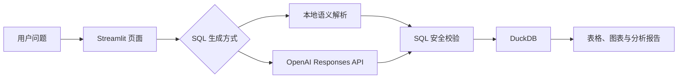

# DataPilot：星河电商 Data Agent Demo

DataPilot 是一个可在本地运行的电商经营分析 Agent Demo。它面向“星河电商”这家虚构综合电商公司，演示自然语言问数、只读 SQL 生成、经营异常巡检、多维诊断、证据分层和补货情景模拟。

> 当前形态是 `Streamlit Web 应用 + DuckDB 数据库 + 可选 OpenAI Responses API`。Codex 用于开发项目，不是应用运行时依赖，也不是 Codex Harness 应用。

## 核心能力

- 自然语言问数：将中文经营问题转换为 SQL，并返回表格和图表。
- 双 SQL 生成模式：无 API Key 时使用本地安全解析；配置 Key 后使用 OpenAI Agent。
- 一键经营巡检：读取核心指标、按品类下钻、形成原因假设并展示任务轨迹。
- 六个月模拟数据：覆盖 2025-01-01 至 2025-06-30，共 4,344 行经营明细。
- 真实业务扰动：包含周周期、促销活动、渠道结构变化和热销 SKU 缺货。
- 证据分层：严格区分数据事实、原因假设和因果结论。
- 补货情景模拟：估算供给恢复后可能恢复的 GMV。
- SQL 安全治理：只允许白名单表的只读查询，拒绝写操作、文件读取、网络读取和真相集访问。

## 系统流程



## 模拟业务数据

| 内容 | 范围 |
|---|---|
| 日期 | 2025-01-01 至 2025-06-30 |
| 品类 | 数码、家电、美妆、服装、食品 |
| SKU | 6 个 |
| 渠道 | 自然推荐、搜索、广告、活动 |
| 经营指标 | GMV、UV、订单、转化率、客单价、库存 |

数据中预置了可验证事件，但事件真相表不会暴露给 Agent：

- 2 月春节活动流量提升；
- 5 月年中预热活动流量提升；
- 6 月广告流量占比提升，但渠道转化效率较低；
- 6 月 17—30 日 `phone_x`、`earbuds_y` 两个热销 SKU 缺货。

## 快速开始

要求 Python 3.10 或更高版本。

```powershell
cd dataAgentDemo
python -m pip install -r requirements.txt
python -m streamlit run app.py
```

浏览器访问 [http://localhost:8501](http://localhost:8501)。首次启动会自动生成 `stardust.duckdb`。

## 自然语言问数

页面顶部输入经营问题，然后点击“生成 SQL 并查询”。例如：

```text
给我拉出最近一周数码下的 GMV 数据
最近30天各品类销售额
近7天数码订单
最近一个月各渠道转化率
按 SKU 查看最近一周 GMV
```

“最近”以模拟数据库中的最新日期 2025-06-30 为基准。页面支持查看最终执行的 SQL。

## 接入 OpenAI API

不配置 API Key 也可以运行，此时使用本地安全解析。配置后可在侧边栏选择 `OpenAI Agent`。

### 页面临时填写

可以直接在页面左侧的“临时填写 OpenAI API Key”输入框中粘贴 Key。输入框使用密码模式，Key 仅保存在当前 Streamlit 会话内，不会写入文件、DuckDB 或 GitHub。点击“清除临时 API Key”或结束会话后失效。

该方式适合本地 Demo。生产部署仍应使用环境变量或专用密钥管理服务。

### 环境变量

在启动 Streamlit 的同一个 PowerShell 窗口中执行：

```powershell
$env:OPENAI_API_KEY="sk-your-api-key"
$env:OPENAI_MODEL="gpt-5-mini"
python -m streamlit run app.py
```

### Streamlit Secrets

也可以复制 `.streamlit/secrets.toml.example` 为 `.streamlit/secrets.toml`：

```toml
OPENAI_API_KEY = "sk-your-api-key"
OPENAI_MODEL = "gpt-5-mini"
```

`.streamlit/secrets.toml` 和 `.env` 已加入 `.gitignore`。不要将真实 API Key 写入源码、提交到 Git，或放入截图。

## SQL 安全边界

无论 SQL 来自本地解析还是模型，都必须通过本地安全层：

- 只接受单条 `SELECT`；
- 只允许 `daily_metrics` 和 `inventory`；
- 禁止 DDL、DML、`PRAGMA`、`ATTACH` 和扩展加载；
- 禁止读取本地文件和网络资源；
- 禁止访问 `event_truth` 和数据集元数据；
- 最多返回 1,000 行；
- 不提供任意 Python 或 Shell 执行工具。

## 测试和自动评测

```powershell
python -m pytest -q
python evaluate.py
```

测试覆盖数据范围、渠道、缺货事件、自然语言转 SQL、真相集隔离、危险 SQL 拦截和端到端报告分层。

## 项目结构

```text
dataAgentDemo/
├── app.py                    # Streamlit 页面
├── evaluate.py               # 自动评测入口
├── datapilot/
│   ├── agent.py              # 一键巡检编排
│   ├── data.py               # 六个月模拟数据与 DuckDB
│   ├── nlq.py                # 本地中文问数解析
│   ├── openai_sql.py         # Responses API SQL 计划生成
│   └── tools.py              # 只读查询和安全校验
├── tests/                    # 自动化测试
├── PRD.md                    # 产品需求
├── ARCHITECTURE.md           # 七层架构
├── METRICS.md                # 指标口径
└── AGENTS.md                 # 开发与 Agent 协作约束
```

## 七层职责

1. 接入：Streamlit 页面和自然语言问题。
2. 语义/本体：指标定义、品类、渠道和时间口径。
3. 规划编排：本地解析、Responses API 和巡检流程。
4. 执行：DuckDB 只读查询和确定性模拟工具。
5. 验证反思：证据校验及事实、假设、因果结论分层。
6. 治理安全：SQL 白名单、真相集隔离和结果行数限制。
7. 交付：指标卡、数据表、Plotly 图表和任务轨迹。

## 当前限制

- 一键巡检仍是固定编排，不是完全自主的多步 Agent。
- OpenAI 模型负责生成 SQL 计划，但不会直接获得数据库执行权限。
- 不包含真实企业数据、用户权限、多租户、长期记忆和自动业务操作。
- 当前情景模拟用于演示，不应作为真实经营决策依据。

## 文档

- [产品需求](PRD.md)
- [系统架构](ARCHITECTURE.md)
- [指标口径](METRICS.md)
- [Agent 约束](AGENTS.md)

